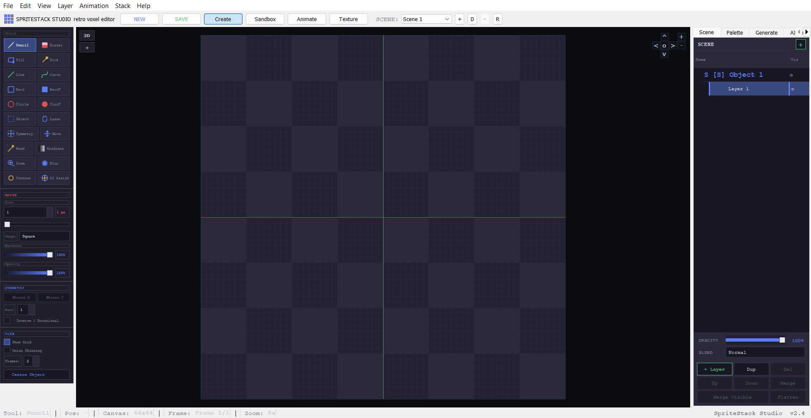
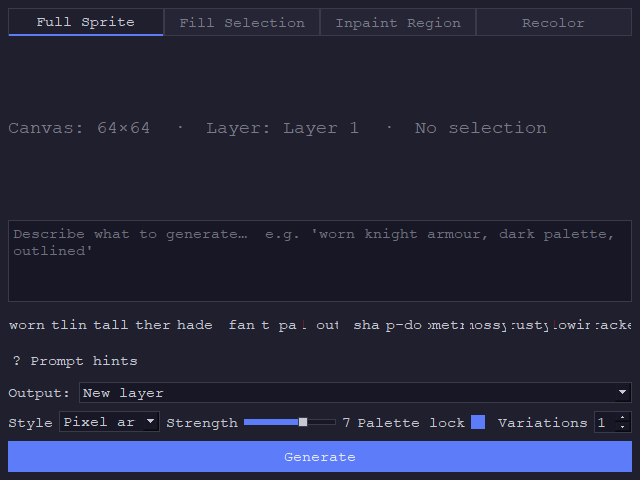
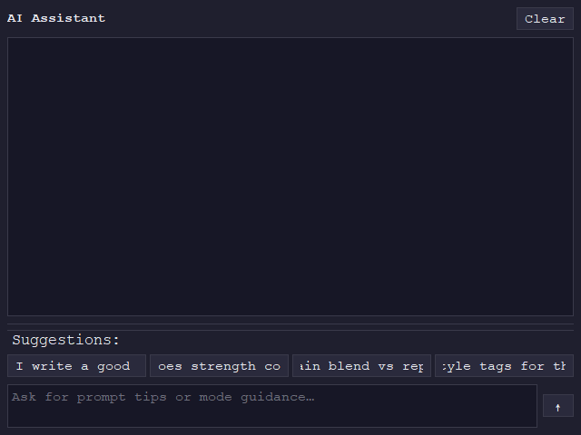
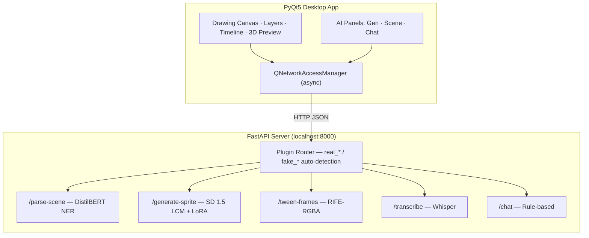
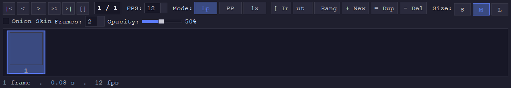

<p align="center">
  
</p>

<h1 align="center">SpriteStack Studio</h1>

<p align="center">
  <strong>A professional pixel art editor &amp; sprite stacking tool with offline AI — draw, animate, stack in 3D, and generate sprites from text.</strong>
</p>

<p align="center">
  
  
  
  
  
</p>

<p align="center">
  <a href="#features">Features</a> •
  <a href="#ai-features-offline--local">AI Features</a> •
  <a href="#getting-started">Getting Started</a> •
  <a href="#ai-model-repositories">Model Repos</a> •
  <a href="docs/02-user-manual.md">User Manual</a>
</p>

---

## Features

<table>
<tr>
<td width="50%">

### Pixel Art Editor
- **14 drawing tools** — Pencil, Eraser, Fill, Eyedropper, Line, Rectangle, Circle, Select, Lasso, Symmetry, Wand, Gradient, Blur, Contour
- Adjustable brush sizes (1–64px) with **symmetry drawing** (Mirror X/Y)
- Full **layer system** — add, remove, duplicate, merge, reorder with opacity & blend modes
- **100-level undo/redo** stack
- HSV color picker, hex/RGB input

</td>
<td width="50%">

### Animation
- Frame-by-frame **animation timeline** with playback controls
- Adjustable FPS, loop/ping-pong/1× modes
- **Onion skinning** for frame alignment
- **AI keyframe prediction** — auto-generate in-between frames
- Export to **animated GIF** and **APNG**

</td>
</tr>
<tr>
<td>

### Sprite Stacking (3D)
- Real-time **3D preview** with rotation and tilt
- Primitive stack generation — Cube, Pyramid, Prism, Cylinder
- Multiple render modes — Stack, Voxel, Billboard
- Auto-rotation, shadows & outlines
- **OBJ/MTL export** for Blender / Unity

</td>
<td>

### Palettes & Export
- Built-in presets: **DB32**, **PICO-8**, **Endesga 32**
- Export: PNG, sprite sheets (horizontal/grid), GIF, APNG
- 3D rotation sheets, layer strips for game engines
- **`.sss` project files** — ZIP-based, preserves everything

</td>
</tr>
</table>

---

## AI Features (Offline & Local)

All AI runs **100% offline** via a local FastAPI server. No cloud, no API keys — everything on your machine.

<table>
<tr>
<td width="50%" align="center">
  <br>
  <sub><b>AI Sprite Generation Panel</b></sub>
</td>
<td width="50%">

### AI Sprite Generation
Type a prompt, get a pixel-art sprite as a new layer.

```
"knight with silver armor and sword"
```

Powered by **Stable Diffusion 1.5 LCM** + **PixelArt LoRA**, with post-processing for hard pixel grids and palette control.

**Features:** Style presets, strength control, palette lock, multiple variations per prompt.

</td>
</tr>
<tr>
<td width="50%">

### AI Scene Construction
Describe a scene in natural language:

```
"tree on left, 3 knights in center, dragon on right"
```

The NLP pipeline (fine-tuned **DistilBERT** NER + **Architect Transformer**) parses entities, positions, and counts, then auto-generates the scene layout.

**Supports:** Voice input via local **Whisper** transcription.

</td>
<td width="50%" align="center">
  <br>
  <sub><b>AI Chat Assistant</b></sub>
</td>
</tr>
</table>

<table>
<tr>
<td align="center" width="25%">

**Keyframe Prediction**<br>
Auto-generate in-between animation frames using a custom **RIFE-RGBA** model (~28ms/frame on CPU). Confidence gating ensures quality.

</td>
<td align="center" width="25%">

**Voice Prompts**<br>
Record a voice command → local **Whisper** transcription → auto-feeds into scene construction. Fully offline.

</td>
<td align="center" width="25%">

**AI Chat Assistant**<br>
Context-aware guidance panel with prompt tips, style suggestions, palette advice, and blend mode recommendations.

</td>
<td align="center" width="25%">

**Plugin Architecture**<br>
`real_*` plugins for GPU inference, `fake_*` fallbacks for testing. Auto-detection of available models. Three-tier fallback chain.

</td>
</tr>
</table>

### AI-Generated Samples

<p align="center">
  
  
  
  
  
</p>
<p align="center">
  <sub>Generated with the built-in AI sprite generator — <code>"knight with silver armor"</code> · <code>"red dragon breathing fire"</code> · <code>"wizard casting spell"</code> · <code>"golden treasure chest"</code> · <code>"skeleton warrior"</code></sub>
</p>

---

## AI Model Repositories

Model weights and training pipelines are maintained in dedicated repositories:

| Component | Description | Model | Repository |
|---|---|---|---|
| **Pixel Art Diffusion** | Text-to-sprite generation pipeline | SD 1.5 LCM + PixelArt LoRA | [spritestack-pixelgen](https://github.com/Azjob21/spritestack-pixelgen) |
| **NLP Scene Parser** | Text-to-scene placement | DistilBERT NER + Architect Transformer | *Separate repo* |
| **Whisper STT** | Voice transcription | whisper-small-en (CTranslate2, int8) | *Separate repo* |
| **Sprite Tweener** | Frame interpolation | RIFE-RGBA (TorchScript) | *Separate repo* |

> **Without models**, the Studio still runs fully — `fake_*` plugins provide procedural fallback responses for end-to-end UI development and testing.

To enable real AI inference, clone the model repos and place weights under `api/models/`.

---

## Architecture



---

## Interface

<table>
<tr>
<td align="center" width="33%">
  <br>
  <sub><b>Full Studio Interface</b></sub><br>
  <sub>Tools · Canvas · Layers · Scene · 3D Preview</sub>
</td>
<td align="center" width="33%">
  <br>
  <sub><b>AI Sprite Generator</b></sub><br>
  <sub>Prompt · Style · Strength · Variations</sub>
</td>
<td align="center" width="33%">
  <br>
  <sub><b>Animation Timeline</b></sub><br>
  <sub>Frames · FPS · Onion Skin · Playback</sub>
</td>
</tr>
</table>

---

## Getting Started

### Requirements
- Python 3.10+
- Windows 10/11

### Installation

```bash
# Clone the repository
git clone https://github.com/Azjob21/spritestack-studio.git
cd spritestack-studio

# Install dependencies
pip install -r requirements.txt

# Launch the editor
python main.py
```

### AI Backend (Optional)

```bash
# In a separate terminal
cd api
pip install -r requirements.txt
python server.py
```

The server starts on `http://127.0.0.1:8000`. The app auto-connects when available.

> **First-time AI setup:** Clone the [model repos](#ai-model-repositories) and place weights under `api/models/`. Without models, the app uses procedural fallbacks.

---

## Keyboard Shortcuts

<table>
<tr>
<td>

| Drawing | |
|---|---|
| `B` | Pencil |
| `E` | Eraser |
| `G` | Fill Bucket |
| `I` | Eyedropper |
| `L` | Line |
| `R` | Rectangle |
| `C` | Circle |
| `S` | Select |

</td>
<td>

| General | |
|---|---|
| `Ctrl+Z/Y` | Undo / Redo |
| `Ctrl+N/O/S` | New / Open / Save |
| `Ctrl+E` | Export |
| `Ctrl+Shift+N` | New Layer |
| `Ctrl+G` | Toggle Grid |
| `Space` | Play/Pause Animation |
| `Scroll` | Zoom |
| `Middle Drag` | Pan |

</td>
<td>

| Animation | |
|---|---|
| `F5` | Add Frame |
| `F6` | Duplicate Frame |
| `F7` | Delete Frame |
| `←` / `→` | Prev / Next Frame |

</td>
</tr>
</table>

---

## Project Structure

```
spritestack-studio/
├── main.py                  # App entry point
├── app/                     # Desktop application (PyQt5)
│   ├── main_window.py       # Main window, menus, AI response handling
│   ├── canvas.py            # Pixel art canvas widget
│   ├── tools.py             # 14 drawing tools
│   ├── layers.py            # Layer management
│   ├── timeline.py          # Animation timeline
│   ├── palette.py           # Color palette & picker
│   ├── preview3d.py         # 3D sprite stack preview (OpenGL)
│   ├── export.py            # All export formats (PNG, GIF, OBJ)
│   ├── scene_model.py       # AI scene layout model
│   ├── scene_ui.py          # AI scene panel UI
│   ├── ai_gen_panel.py      # AI sprite generation panel
│   └── ai_chat_panel.py     # AI chat assistant panel
├── api/                     # Local FastAPI AI backend
│   ├── server.py            # API server with plugin routing
│   ├── plugins/
│   │   ├── real_*.py        # Real model inference handlers
│   │   └── fake_*.py        # Procedural fallback handlers
│   └── models/              # Not tracked — see model repos
└── docs/                    # Documentation & screenshots
```

---

## AI Model Summary

| Feature | Model | Architecture | Size | Speed |
|---|---|---|---|---|
| Scene Parser | SpriteStack NER v2 | DistilBERT (Token Classification) | 265 MB | ~50ms CPU |
| Voice Input | whisper-small-en | Whisper (CTranslate2, int8) | 483 MB | ~1–3s CPU |
| Sprite Gen | DreamShaper 8 LCM + LoRA | Stable Diffusion 1.5 + LCM | 4.3 GB | 2–8s GPU / ~120s CPU |
| Tweening | RIFE-RGBA | Custom IFNet (TorchScript) | 43 MB | ~28ms CPU |
| Chat | Rule-based | Keyword matching | — | <1ms |

> For detailed architecture documentation, see [AI_FEATURES.md](AI_FEATURES.md).

---

## Credits

- **Course module** supervised by **Prof. Chaib Souleyman**
- **AI Models:** DreamShaper 8 LCM, PixelArt Redmond LoRA, Whisper, RIFE
- **Libraries:** PyQt5, PyTorch, Hugging Face `diffusers` & `transformers`, FastAPI, Pillow, OpenGL

## License

MIT License — see [LICENSE](LICENSE) for details.

Model weights maintain their original licences.
